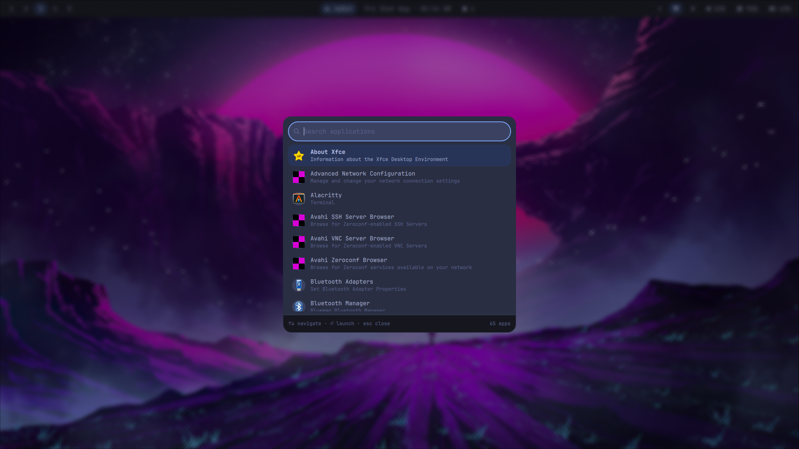
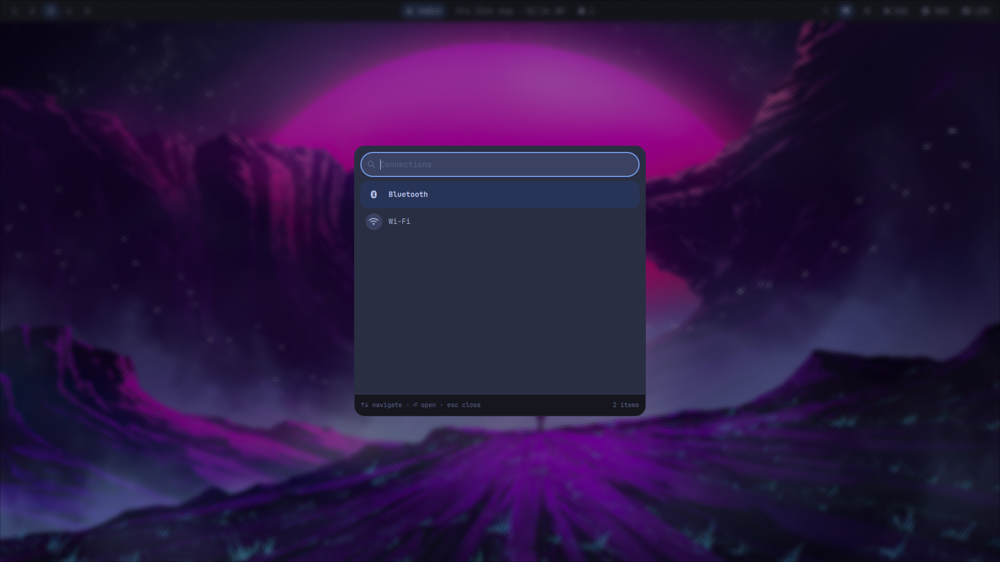
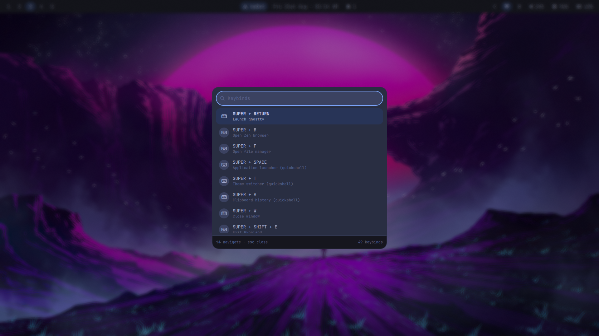
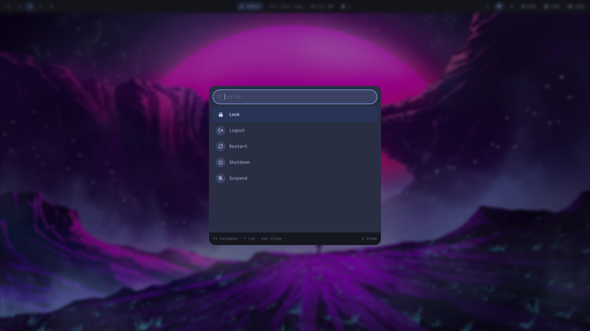
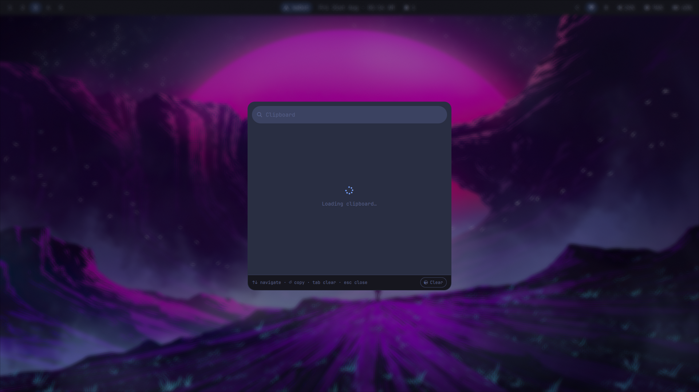
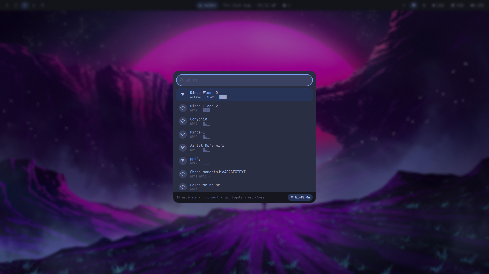
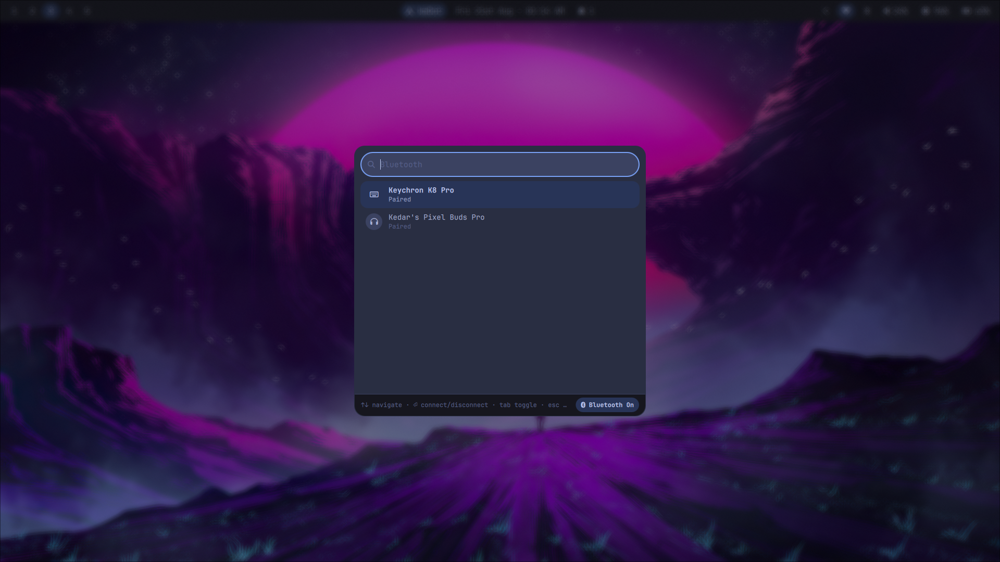
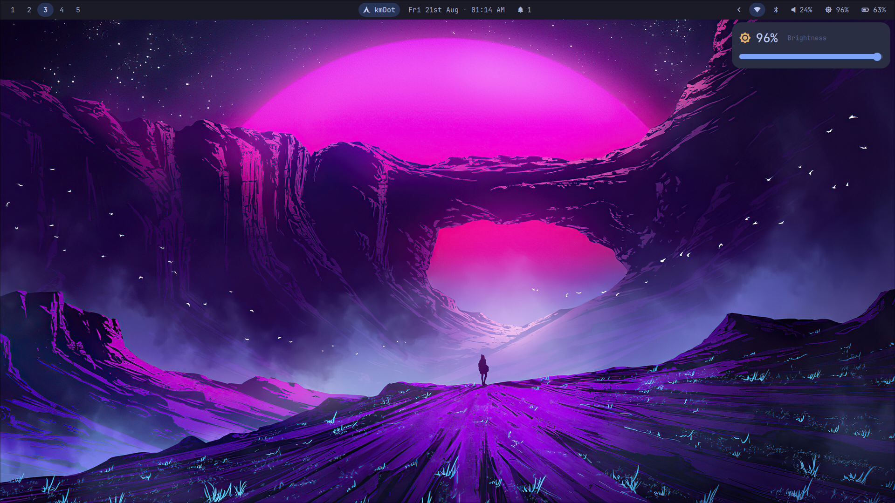
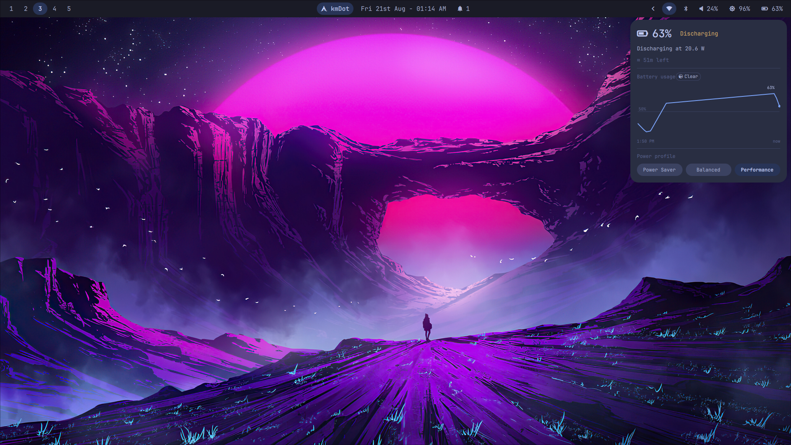
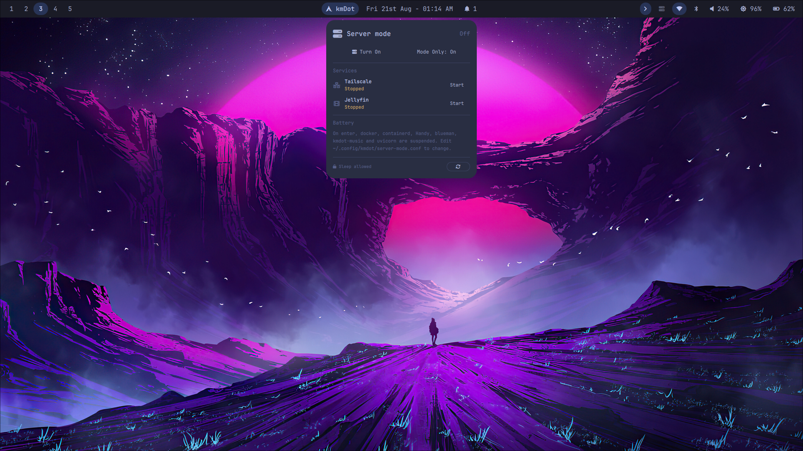

# kmDot

Dotfiles for CachyOS + Hyprland. Source of truth is this repo; sync copies config to `~/.config/kmdot` and symlinks to standard locations.

## Apps

fish · ghostty · herdr · hyprland · nvim · starship · tmux · xdg-desktop-portal · theme-switcher · battery · quickshell

## Screenshots

The screenshots below were captured show the current Quickshell interface without an application window behind it.

### Launchers









### Topbar Menus









## Install

```bash
sudo pacman -S gum
./config-install.sh   # multi-select TUI
```

Single-app re-sync: `./sync/<app>.sh` (skips TUI).

## Theme Switching

```bash
theme-switcher/main.sh <theme>
```

Or via the quickshell theme launcher (Super+T, after sync):

```bash
~/.config/kmdot/quickshell/scripts/toggle.sh kmdot-theme
```

Themes: catppuccin, everforest, nord, onedark, tokyonight

## Tmux

- Prefix: `C-s`
- Config: `config/tmux/conf.d/` (modular: 00-base, 10-bindings, 20-theme, 90-plugins)
- Reload: `C-s r`
- TPM: `git clone https://github.com/tmux-plugins/tpm ~/.tmux/plugins/tpm`
- UTF-8 locale required for Nerd Fonts (`LANG=en_IN.UTF-8`)

## Herdr

- Terminal workspace manager (workspaces / tabs / panes); config: `config/herdr/`
- Tabs auto-name `<tab number>. <directory name>` (numbering starts at 1, per workspace): `ui.prompt_new_tab_name = false` skips the new-tab name prompt, and `scripts/herdr-tab-title.mjs` — run by the fish prompt hook (`config/fish/config.fish`) whenever `$PWD` changes — renames the calling pane's tab. A tab you rename by hand is left alone; rename it back to a bare number to hand it back to the auto-namer. Fish-only trigger (bash panes keep herdr's numeric names).
- Reload: `herdr server reload-config`

## Troubleshooting

- **No wallpaper after login/theme switch**: the backend is `awww` — make sure `awww-daemon` is running (`pgrep -x awww-daemon`); the scripts start it automatically, and `install.sh` installs `awww`.
- **Tmux Nerd Font glyphs missing**: set `LANG=en_IN.UTF-8 LC_ALL=en_IN.UTF-8`.
