# kmDot

Dotfiles for CachyOS + Hyprland. Source of truth is this repo; sync copies config to `~/.config/kmdot` and symlinks to standard locations.

## Apps

codex · fish · ghostty · herdr · herdr-app · hyprland · nvim · pi · starship · tmux · xdg-desktop-portal · theme-switcher · battery · quickshell

Codex CLI (`@openai/codex`) and Pi coding agent (`@mariozechner/pi-coding-agent`) install from their official npm packages. Their versions are pinned in the installer. No AUR packages or helpers are used.

## Dictation

Install Hex separately using its [official Linux instructions](https://github.com/anomalyco/hex/blob/dev/docs/linux.md#install-a-published-build). Hyprland binds **Alt+Space** to Hex dictation and **Super+H** to Hex’s History window. Hex handles recording feedback, models, and transcripts in its own app. Enable **Launch at login** in Hex if you want the shortcuts available when you sign in.

## Screenshots

The screenshots below were captured on an empty Hyprland workspace with no application window behind the Quickshell interface. They document the current R1 redesign, including the shared launcher/popup shell, inline utility tray, responsive controls, and themed wallpaper surface.

### Top bar

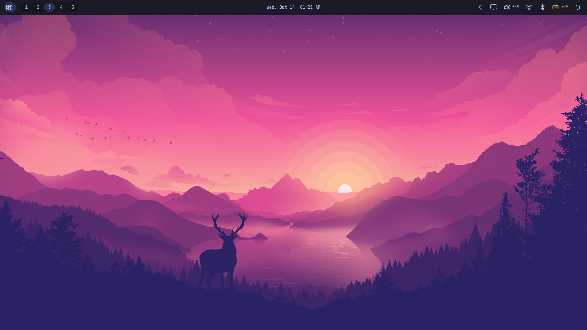

### Launchers

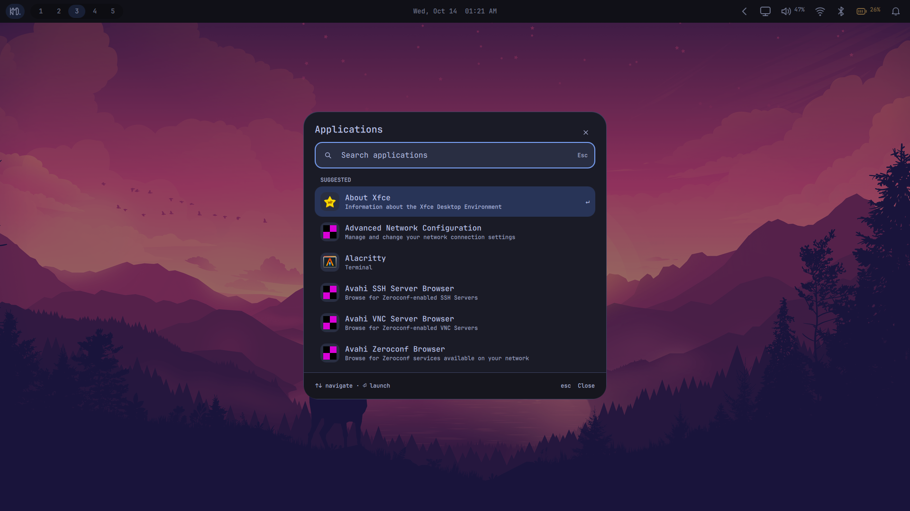
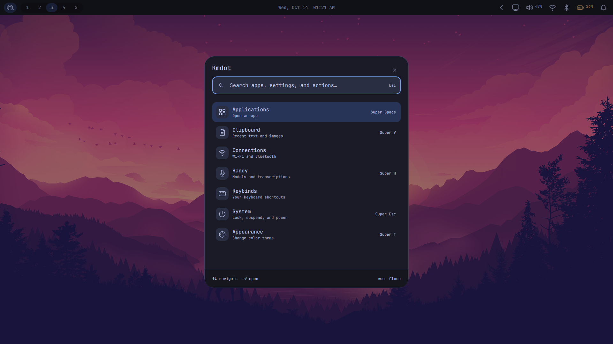
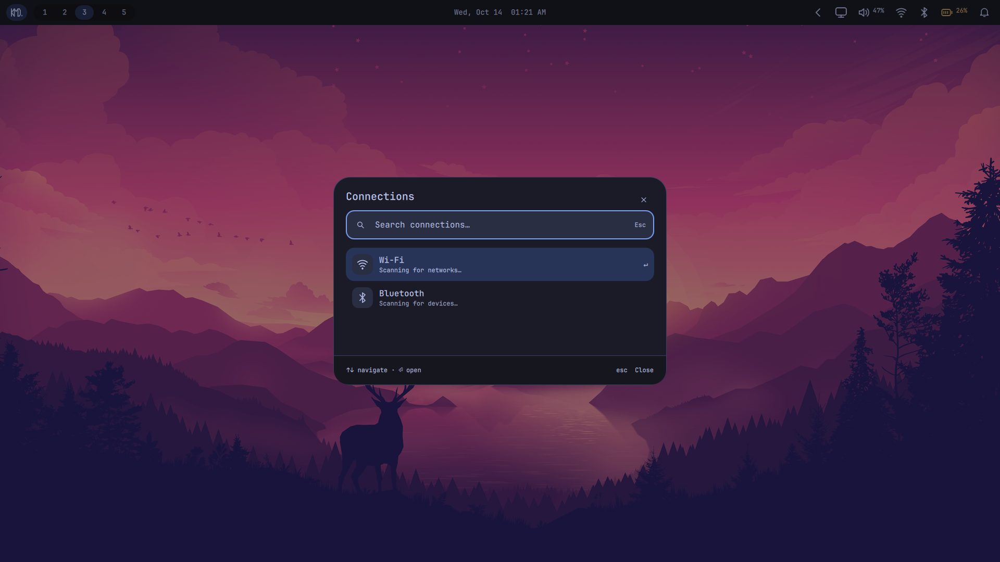

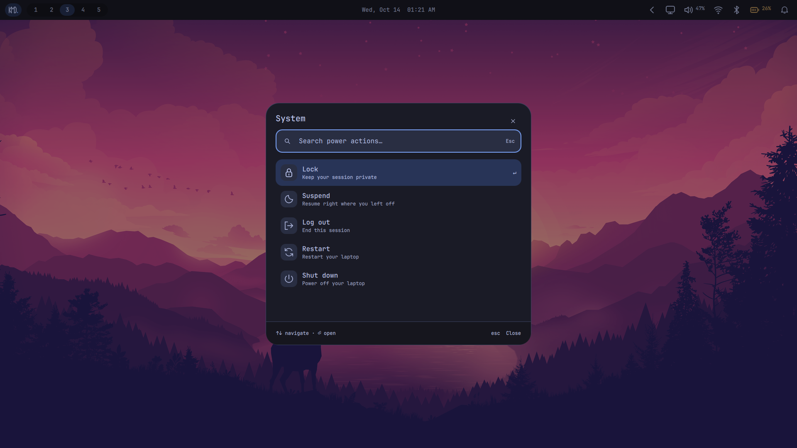
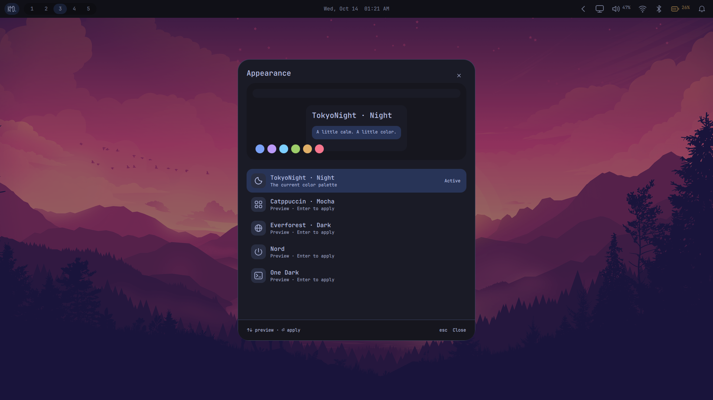
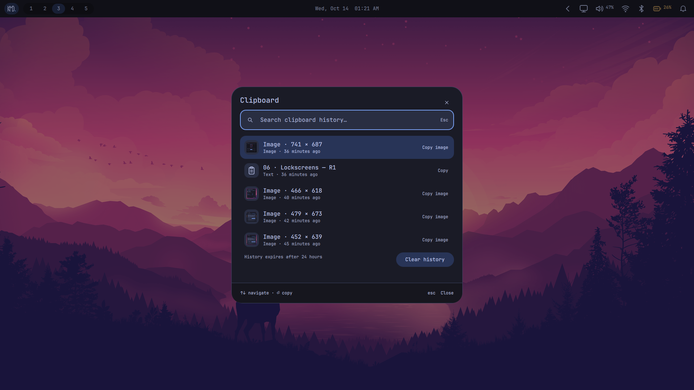
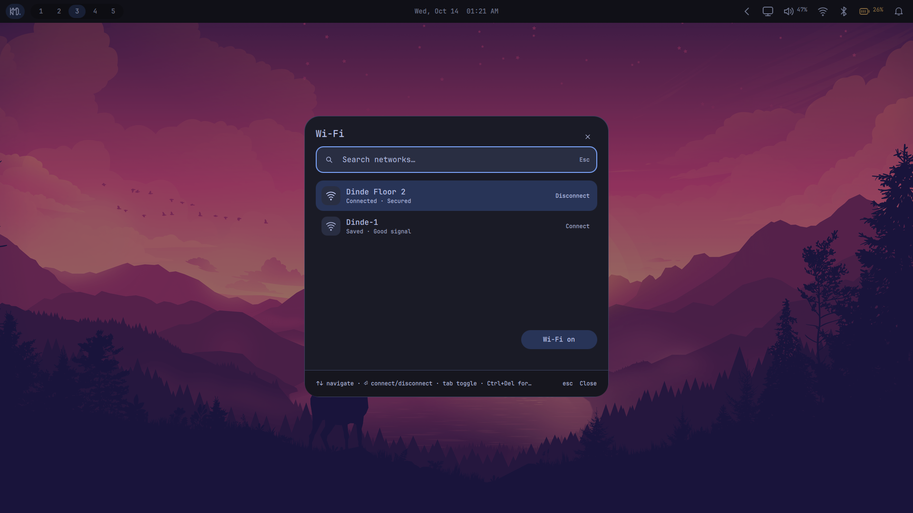
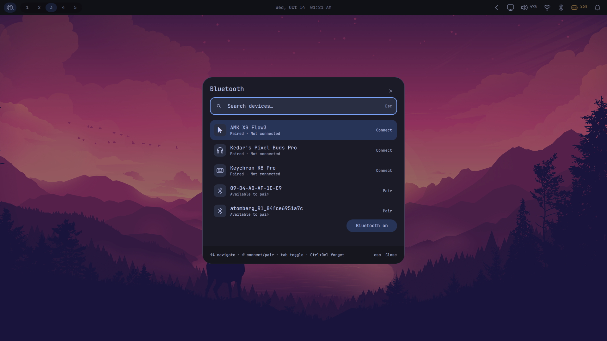

### Panels and menus

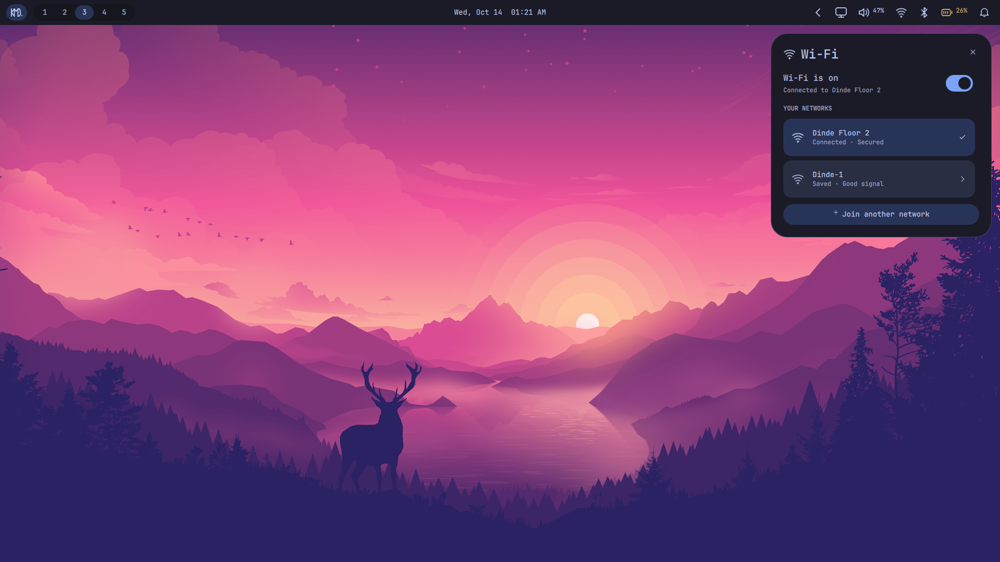
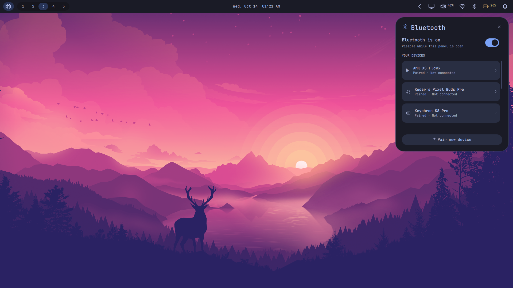
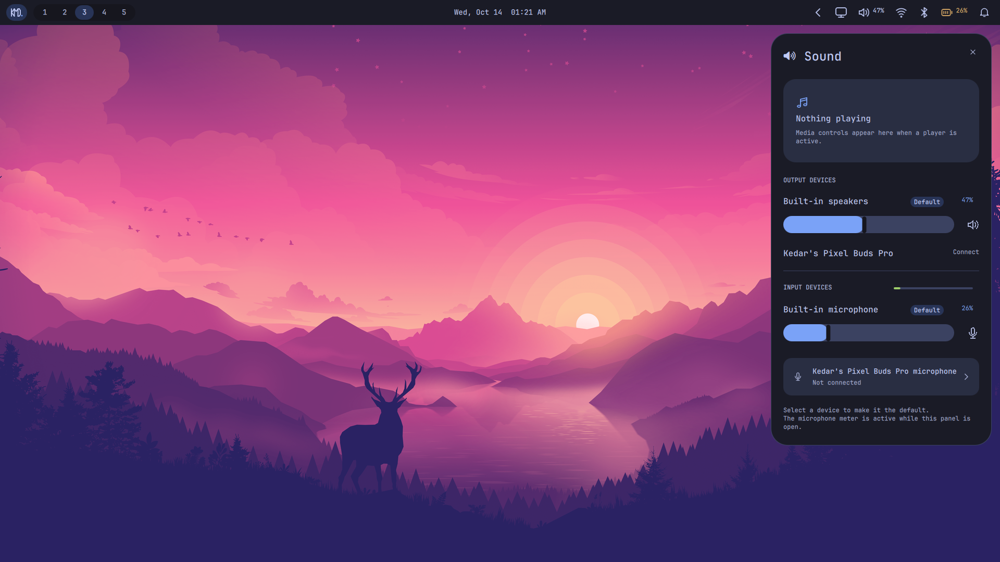
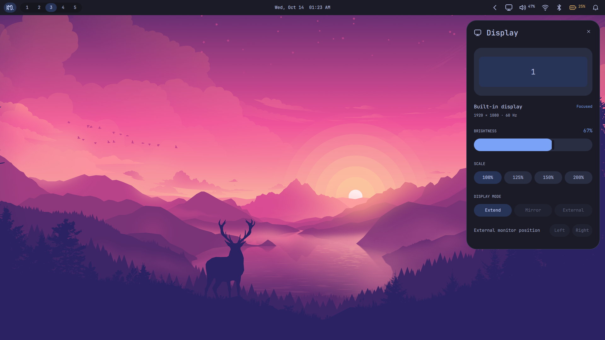
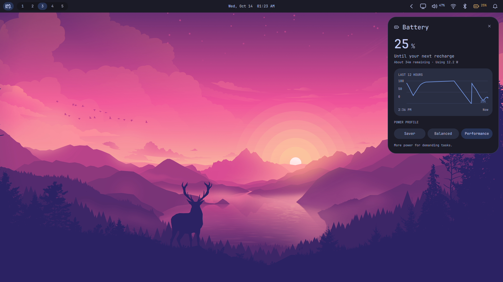
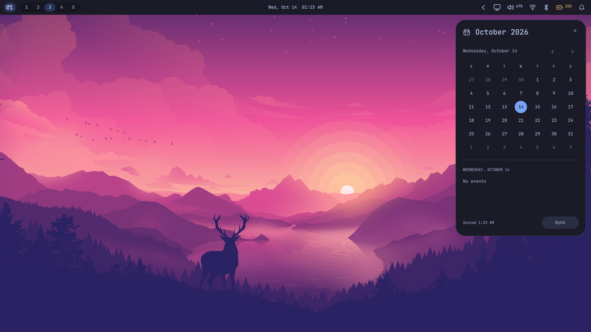
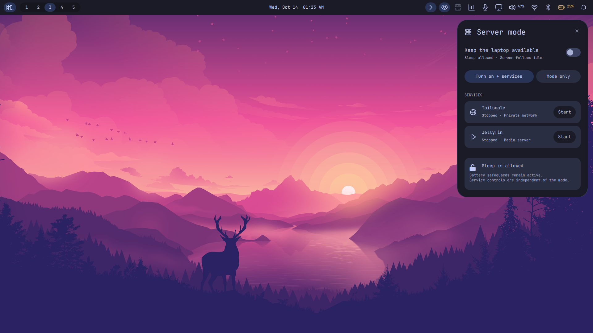
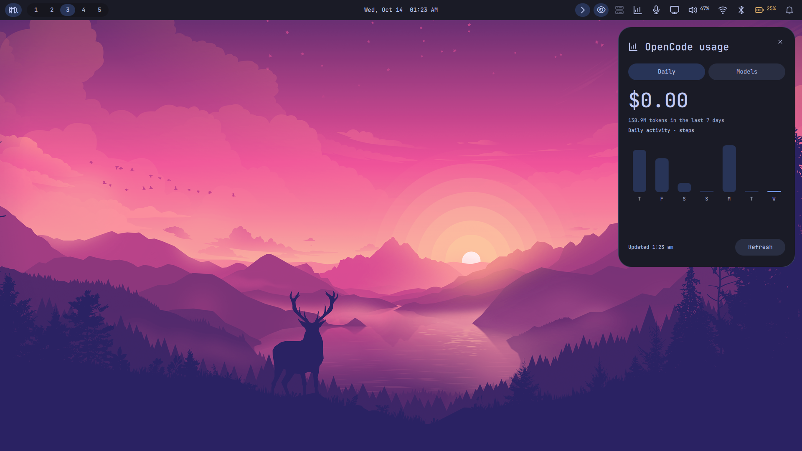
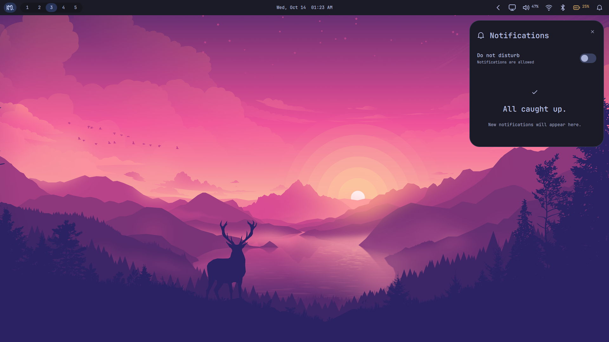

## Install

For a fresh physical laptop install, follow the [Arch Linux and kmDot setup guide](docs/install/arch-laptop-setup.md) from preparing the USB through the final smoke check.

For an already installed Arch system:

```bash
./install.sh --all
./config-install.sh --all
```

Single-app re-sync: `./sync/<app>.sh` (skips TUI).

## Theme Switching

```bash
theme-switcher/main.sh <theme>
```

Or via the quickshell theme launcher (Super+T, after sync):

```bash
~/.config/kmdot/quickshell/scripts/toggle.sh kmdot-theme
```

Themes: catppuccin, everforest, nord, tokyonight

## Tmux

- Prefix: `C-s`
- Config: `config/tmux/conf.d/` (modular: 00-base, 10-bindings, 20-theme, 90-plugins)
- Reload: `C-s r`
- TPM: `git clone https://github.com/tmux-plugins/tpm ~/.tmux/plugins/tpm`
- UTF-8 locale required for Nerd Fonts (`LANG=en_IN.UTF-8`)

## Herdr

- Terminal workspace manager (workspaces / tabs / panes); config: `config/herdr/`
- Tabs auto-name `<position>. <directory name>` (starts at 1, per workspace, follows the visible tab order): `ui.prompt_new_tab_name = false` skips the new-tab name prompt; a fish prompt hook renames a tab the moment its pane `cd`s; and the `plugins/kmdot-tab-titles` plugin (event hooks on tab create/close/move and pane close/exit) renumbers every tab when the tab topology changes — including deleting a tab by closing its last pane (prefix+x) or exiting its shell, which closes the tab without a `tab.closed` event. A tab you rename by hand is left alone; rename it back to a bare number to hand it back to the auto-namer. cd-following is fish-only (bash panes keep their name until a topology event).
- Reload: `herdr server reload-config`

## Herdr App

- Official native desktop app (`herdr-app`) for the same `hc` terminals Herdr TUI drives; config: `config/herdr-app/`
- Tracked (user-authored only): `settings.json`, `keys.json`, `layouts/kmdot.json`, and the `mods/kmdot-tab-titles/` and `mods/tmux-prefix/` mods
- Theme sources: `themes/<theme>/herdr-app.json`; `theme-switcher/hooks/herdr-app.sh` copies the selected palette to the generated `~/.config/herdr-app/themes/kmdot-active.json` (the layout and settings reference that fixed name)
- Not tracked (app-managed, generated, or runtime): shipped layouts/themes/mods, `themes/kmdot-active.json`, `shared.json`, `installed.json`, `seen.json`, `window.json`, `herdr-app.sock`, `data/`, `frame/`, and generated `*.d.ts`/`jsconfig.json`
- `./sync/herdr-app.sh` copies into `~/.config/herdr-app` **in place** (never replaces the directory, since it doubles as the app's runtime home), seeds the active theme, and points the active layout at `kmdot`
- Reload: config files and theme are picked up live; no restart needed

## Troubleshooting

- **No wallpaper after login/theme switch**: the backend is `awww` — make sure `awww-daemon` is running (`pgrep -x awww-daemon`); the scripts start it automatically, and `install.sh` installs `awww`.
- **Tmux Nerd Font glyphs missing**: set `LANG=en_IN.UTF-8 LC_ALL=en_IN.UTF-8`.
